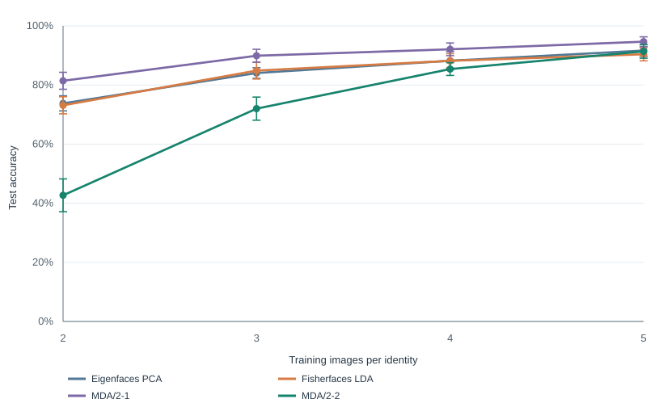
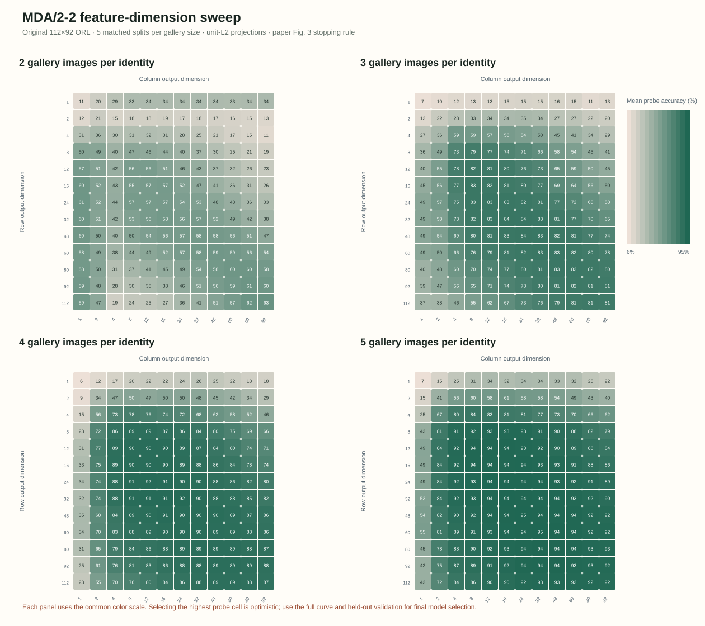
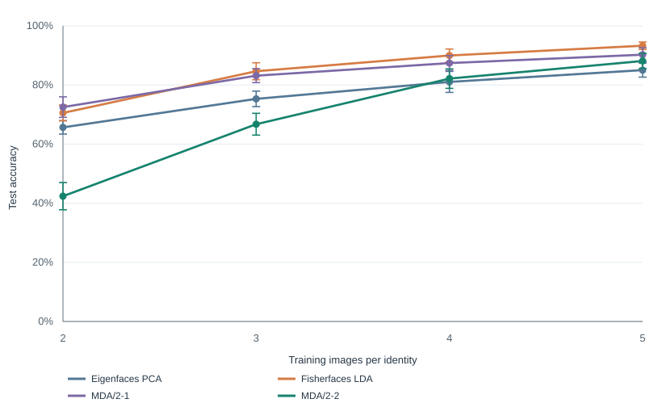

# COMP3314 Group 27 — MDA face-recognition replication

This is the working research repository for COMP3314 Group 27's study of Yan et al., “Multilinear Discriminant Analysis for Face Recognition” (IEEE TIP, 2007). It records the research question, implementation, protocols, run artifacts, limitations, progress, and handoff materials.

**Current status:** the original-resolution fixed-setting study (30 matched splits), matched normalization sensitivity run, and five-repeat dimension sweep are complete. The independent implementation audit and final report integration remain. We cannot recreate the exact original Table I run because the paper omits split seeds, repeat count, and complete feature-dimension selection details. See [progress](docs/PROGRESS.md) and the [original-resolution experiment record](docs/experiments/2026-10-28-original-resolution-reproduction.md).

**GitHub:** [private working repository](https://github.com/Lavalx100/comp3314-mda-face-recognition-replication) · Review attribution and course policy as a group before making it public.

## Research question

When image structure, training/test examples, and the classifier are controlled, does matrix-based MDA improve face identification over vector-based Eigenfaces PCA and Fisherfaces LDA, particularly with few training images per identity?

## Quick start

Requires Python 3.10 or newer. From this directory:

```bash
python3 -m venv .venv
source .venv/bin/activate
python3 -m pip install -r requirements.txt
python3 -m unittest discover -s tests -v
```

To view the project overview locally, run `python3 -m http.server 8000` from this directory and open `http://127.0.0.1:8000/site/`.

Download the official Cambridge `att_faces.zip` archive into the ignored local cache (see [data instructions](docs/data-and-ethics.md)). The archive and face images are not committed:

```bash
mkdir -p .cache/orl-original
curl -L https://www.cl.cam.ac.uk/research/dtg/attarchive/pub/data/att_faces.zip \
  -o .cache/orl-original/att_faces.zip
```

Run the 30-split primary study and matched-seed scaling sensitivity:

```bash
python3 src/run_experiment.py --repeats 30 --output-dir results/rerun/unit_l2
python3 src/run_experiment.py --projection-normalization within_scatter \
  --repeats 30 --output-dir results/rerun/within_scatter
python3 scripts/analyze_paired_results.py results/rerun/unit_l2/raw_results.csv
```

The scikit-learn dataset is fetched and cached locally under `.cache/olivetti/`; it is not committed. Each run writes split-level CSV, summary CSV/JSON, an SVG chart, and the MDA objective trace. Keep outputs from each configuration in a separate folder.

Run the original-resolution paper-style follow-up with the paper's Fig. 3 stopping condition:

```bash
python3 src/run_experiment.py --dataset orl-original --repeats 30 \
  --max-iter 10 --fisher-pca-max 10400 --mda-stopping-rule paper_figure \
  --output-dir results/rerun/orl-original/unit_l2
python3 src/run_experiment.py --dataset orl-original --projection-normalization within_scatter \
  --repeats 30 --max-iter 10 --fisher-pca-max 10400 \
  --mda-stopping-rule paper_figure \
  --output-dir results/rerun/orl-original/within_scatter
python3 scripts/analyze_paired_results.py results/rerun/orl-original/unit_l2/raw_results.csv
```

The completed original-resolution MDA/2-2 feature sweep can be rerun with:

```bash
python3 scripts/run_orl_dimension_sweep.py --mda-stopping paper_figure \
  --mda-dimensions 1,2,4,8,12,16,24,32,48,60,80,92,112 --repeats 5 \
  --output-dir results/rerun/orl-original/dimension-sweep
python3 scripts/render_mda_dimension_heatmap.py \
  results/rerun/orl-original/dimension-sweep/dimension_summary.csv \
  results/rerun/orl-original/dimension-sweep/mda22_dimension_heatmap.svg
```

The sweep writes a checkpoint after every completed split. If interrupted, rerun the same command with `--resume` to continue using those rows; changing the dataset hash or sweep settings will reject the checkpoint.

Quick smoke run (not for reported results):

```bash
python3 src/run_experiment.py --train-per-class 2,5 --repeats 1 --max-iter 2 \
  --output-dir results/smoke
```

## Repository map

```text
src/run_experiment.py      PCA, Fisherfaces, MDA/2-1, MDA/2-2, and run outputs
src/orl_data.py            Reader for the original Cambridge PGM archive
scripts/analyze_paired_results.py  Paired split differences and bootstrap ranges
scripts/run_orl_dimension_sweep.py  Original-resolution feature-dimension sweep
scripts/render_mda_dimension_heatmap.py  SVG visualization of the MDA/2-2 grid
tests/                     Deterministic unit tests for core functions
results/                   Dated baseline, follow-up, and smoke artifacts kept separate
docs/research-plan.md      Questions, hypotheses, stages, and assessment mapping
docs/protocol.md           Current data/split/model/evaluation protocol
docs/paper-notes.md        Paper summary and original ORL comparison values
docs/experiments/          Dated experiment records and handoff notes
docs/PROGRESS.md           Status, completed work, and next steps
docs/CHANGELOG.md          Human-readable project change history
report/main.tex            Preliminary report source based on the earlier 64×64 study; update before submission
slides/                    Nine-minute presentation outline and Q&A prep
site/index.html            Local research overview, plan, results, and team roles
```

The report source is preliminary and describes the earlier 64×64 study. It needs updating with the original-resolution results before submission; the old compiled PDF is not included so it cannot be mistaken for the final report.

## Original-resolution fixed-setting results

Mean accuracy ± sample SD across 30 matched splits, percent. These settings are fixed (PCA 36, Fisherfaces up to 36, MDA/2-1 with 6 row features, and MDA/2-2 with 6×6 features); they do not reproduce the paper's best-over-dimension selection.

| Train images/person | Eigenfaces PCA | Fisherfaces LDA | MDA/2-1 | MDA/2-2 (6×6) |
|---:|---:|---:|---:|---:|
| 2 | 73.8 ± 2.5 | 73.1 ± 2.9 | 81.4 ± 2.9 | 42.7 ± 5.5 |
| 3 | 84.0 ± 1.8 | 84.9 ± 2.8 | 89.9 ± 2.2 | 72.0 ± 3.9 |
| 4 | 88.2 ± 3.1 | 88.2 ± 2.4 | 92.1 ± 2.1 | 85.4 ± 2.2 |
| 5 | 91.6 ± 2.0 | 90.4 ± 2.2 | 94.6 ± 1.6 | 91.4 ± 2.3 |



The main mismatch is fixed 6×6 MDA/2-2 at two and three gallery images. The paper reports a best-over-dimension MDA/2-2 score of 90.1% with two gallery images; our fixed 6×6 mean is 42.7%. The completed dimension sweep tests how much feature size changes the result, but its best grid values are probe-selected and optimistic.

## Dimension-sweep findings

The five-repeat sweep retained all 156 feasible MDA/2-2 row/column pairs, along with PCA, Fisherfaces, and MDA/2-1 feature curves. The best cell for each method/gallery size was selected using the same probe splits, so these values are diagnostic and optimistic; they are not unbiased test estimates.

| Gallery images/person | PCA best | Fisherfaces best | MDA/2-1 best | MDA/2-2 best | Paper MDA/2-2 |
|---:|---:|---:|---:|---:|---:|
| 2 | 76.7% (79) | 74.4% (26) | 83.1% (9 rows) | 62.9% (112×92) | 90.1% |
| 3 | 85.9% (118) | 86.1% (38) | 90.5% (10 rows) | 83.6% (32×16) | 95.0% |
| 4 | 89.3% (159) | 88.7% (39) | 92.6% (10 rows) | 91.8% (32×24) | 98.3% |
| 5 | 92.5% (66) | 90.0% (38) | 94.5% (15 rows) | 94.6% (48×24) | 99.0% |

Parentheses show selected feature dimensions. At two gallery images, the MDA/2-2 grid's best point uses the entire 112×92 image (10,304 features) and still reaches only 62.9%. Dimension selection explains part, but not all, of the gap from Table I. This remains a paper-style follow-up, not an exact reconstruction or a verdict on the paper.



Download the [full sweep summary](results/2026-10-28-original-resolution-dimension-sweep/paper_figure_unit_l2/dimension_summary.csv), [probe-selected maxima and dimensions](results/2026-10-28-original-resolution-dimension-sweep/paper_figure_unit_l2/best_by_gallery.csv), and [published Table I transcription](results/2026-10-28-original-resolution-dimension-sweep/paper_figure_unit_l2/published_table_i.csv). The [dated experiment record](docs/experiments/2026-10-28-original-resolution-reproduction.md) explains the methods, outputs, sensitivity results, and limitations.

## Earlier 64×64 partial study

Historical protocol: mean accuracy ± sample SD across 30 matched splits, percent:

| Train images/person | Eigenfaces PCA | Fisherfaces LDA | MDA/2-1 | MDA/2-2 |
|---:|---:|---:|---:|---:|
| 2 | 65.7 ± 2.3 | 70.6 ± 2.6 | 72.5 ± 3.5 | 42.4 ± 4.6 |
| 3 | 75.3 ± 2.6 | 84.7 ± 2.9 | 83.2 ± 2.4 | 66.7 ± 3.7 |
| 4 | 81.0 ± 3.6 | 90.0 ± 2.2 | 87.4 ± 2.5 | 82.2 ± 3.3 |
| 5 | 85.0 ± 2.4 | 93.3 ± 1.3 | 90.2 ± 2.3 | 88.1 ± 2.6 |



The original five-split exploratory run remains preserved separately at `results/2026-10-24-partial-replication/`; see the [30-split 64×64 follow-up record](docs/experiments/2026-10-28-30-repeat-followup.md). Do not merge 64×64 and original-resolution results.

## Reproducibility and data handling

- Split seeds are deterministic and identical across methods for each train count/repeat.
- Learned projections use training data only; test examples are used only for evaluation.
- Dataset cache and raw face archive are excluded from version control. Cite AT&T Laboratories Cambridge and scikit-learn's loader documentation.
- Record each new experiment under `docs/experiments/` with command, configuration, seed policy, output paths, interpretation, and limitations before changing the headline result.
- The course brief asks for a public GitHub repository for code submitted for reproduction bonus consideration. Keep this working repository private until the group reviews its contents and explicitly decides whether to publish it.

## References

- Yan, Xu, Yang, Zhang, Tang, and Zhang (2007), [paper PDF](https://mmlab.ie.cuhk.edu.hk/archive/2007/IP07_face02.pdf), DOI [10.1109/TIP.2006.884929](https://doi.org/10.1109/TIP.2006.884929).
- scikit-learn, [Olivetti faces dataset documentation](https://scikit-learn.org/stable/datasets/real_world.html#olivetti-faces-dataset).
