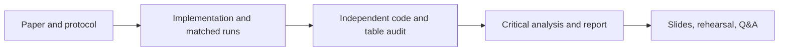

# Four-person work plan

## Person 3 — experiment and reproducibility owner

Your job is to make the comparison runnable, fair across methods, and easy for teammates to inspect. You own both the frozen 64×64 partial study and the original-resolution ORL follow-up; the latter must be labeled as a reproducible follow-up because the paper omits its exact split seeds, repeat count, and complete dimension search.

### Work you own

1. **Keep both protocols visible.** Preserve the 64×64 30-split runs, and use the official 112×92 PGM archive for the new original-resolution run. Keep every configuration in its own dated folder.
2. **Maintain and audit the implementation.** Run PCA, Fisherfaces/O, MDA/2-1, and MDA/2-2 with shared gallery/probe splits, training-only projections, and Euclidean 1-NN. The dimension sweep must save each configuration rather than only its winner.
3. **Match the paper where possible.** Use the original 112×92 images, per-image histogram equalization, gallery sizes 2/3/4/5, and nearest-neighbour classification. Record the MDA update order, projection scaling, and Fig. 3 stopping condition; distinguish these choices from details the paper leaves unspecified.
4. **Explain results without overclaiming.** The article reports best accuracies across feature dimensions. Our sweep's best-probe values are test-selected and optimistic; show full curves and keep the repeated fixed-setting estimate separate. Never call this an exact reconstruction of the original random runs.
5. **Handoff for verification.** Give Person 2 the source paper, PGM loader, equations, raw split results, and dimension sweep. Ask them to check the implementation against Sections II and IV and independently verify the paper Table I transcription. Record findings and corrections.
6. **Support the report and talk.** Give Person 4 the paper-versus-group table, dimension curves, runtime/objective outputs, and exact caveats. Explain split sharing, train-only fitting, mode-wise scatters, axis scaling, and dimension selection.
7. **Track changes.** Make small commits with descriptive messages; update [`PROGRESS.md`](PROGRESS.md), [`CHANGELOG.md`](CHANGELOG.md), and the dated experiment note whenever the protocol or results change.

### Run instructions

From the project root, after installing [`requirements.txt`](../requirements.txt):

```bash
python3 -m unittest discover -s tests -v
python3 src/run_experiment.py --repeats 30 \
  --output-dir results/rerun/unit_l2
python3 src/run_experiment.py --projection-normalization within_scatter \
  --repeats 30 --output-dir results/rerun/within_scatter
python3 scripts/analyze_paired_results.py results/rerun/unit_l2/raw_results.csv
```

Original-resolution 30-split run and paper-style dimension sweep:

```bash
python3 src/run_experiment.py --dataset orl-original --projection-normalization unit_l2 \
  --mda-stopping-rule paper_figure --repeats 30 --max-iter 10 --fisher-pca-max 10400 \
  --output-dir results/orl-original-fixed/unit_l2
python3 src/run_experiment.py --dataset orl-original --projection-normalization within_scatter \
  --mda-stopping-rule paper_figure --repeats 30 --max-iter 10 --fisher-pca-max 10400 \
  --output-dir results/orl-original-fixed/within_scatter
python3 scripts/run_orl_dimension_sweep.py --mda-stopping paper_figure --repeats 5 \
  --mda-dimensions 1,2,4,8,12,16,24,32,48,60,80,92,112 \
  --output-dir results/orl-original-dimension-sweep
python3 scripts/render_mda_dimension_heatmap.py \
  results/orl-original-dimension-sweep/dimension_summary.csv \
  results/orl-original-dimension-sweep/mda22_dimension_heatmap.svg
```

Use the same paired-analysis command with the alternate run's `raw_results.csv`. Keep fresh outputs in a new folder; the checked-in `2026-10-28-30-repeat-followup` artifacts are the current dated study.

### Current handoff checklist

- [x] Four methods share each 64×64 split; learned transforms use training data only.
- [x] 30 splits per gallery count under both normalization settings.
- [x] Original-resolution 112×92 fixed-setting split-level runs complete under both projection normalizations; the 5-repeat dimension sweep is complete.
- [x] Raw CSVs, summary CSV/JSON, charts, objective traces, dimension heatmap, and paired comparisons saved.
- [x] Preliminary three-page report source exists for the earlier 64×64 study; the stale compiled PDF was removed during cleanup. Update the draft with the original-resolution study before submission.
- [ ] Person 2 completes independent algorithm and table audit.
- [ ] Person 4 integrates final analysis into the 3–4-page submission and presentation.
- [ ] All four rehearse the talk and Q&A; team reviews the repository before any public release.

## Other team members

| Person | Main ownership | Concrete outputs |
|---|---|---|
| 1 — Paper and methods | Explain the DTC, alternating mode updates, and course links | Method diagram, equation/notation check, paper-page references, Q&A prep |
| 2 — Protocol and evidence audit | Check ORL preprocessing, gallery/probe setup, baselines, and paper-to-code fidelity | Independent discrepancy checklist and verified results table |
| 3 — Experiment and reproducibility | Own code, split-level results, paired analysis, experiment records, and Git history | Runnable study and reproducibility handoff (this section) |
| 4 — Critical analysis and editor | Integrate strengths, assumptions, limitations, extensions, and team sections | Final report, slide flow, references/captions, timed rehearsal |

**Coding allocation:** Person 3 is the only member with primary model/data/experiment implementation assigned. Person 2 has a code-and-protocol audit (review and reproduce checks, with fixes only if the team agrees). Person 1's method diagram and Person 4's report/slides may use LaTeX/SVG/slide tools, but they do not own ML implementation.

Everyone reviews the final claims and attends the nine-minute presentation and three-minute Q&A. Ownership divides work; it does not replace understanding the whole project.

## Shared workflow


