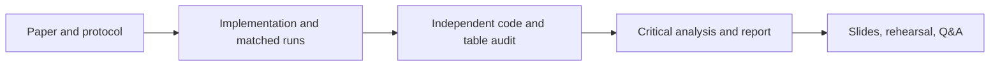

# Four-person work plan

## Person 3 — experiment and reproducibility owner

Your job is to make the comparison runnable, fair across methods, and easy for teammates to inspect. The implementation and 30-split experiments are complete; the remaining work is an independent audit, handoff, and clear presentation of the caveats.

### Work you own

1. **Keep the protocol fixed and visible.** The study uses scikit-learn's 64×64 Olivetti copy, gallery sizes 2/3/4/5, 30 deterministic splits per size, shared splits across methods, training-only projection fitting, and Euclidean 1-NN. Record any change before rerunning.
2. **Maintain the four-method implementation.** Keep PCA, Fisherfaces, MDA/2-1, and MDA/2-2 settings and numerical safeguards documented in [`protocol.md`](protocol.md) and the run metadata.
3. **Preserve results by run.** Do not overwrite the initial five-split exploratory run. The 30-split unit-L2 primary run and within-scatter sensitivity run have separate folders with raw rows, summaries, charts, and objective traces.
4. **Explain results without overclaiming.** Under unit-L2 axes, MDA/2-1 leads at two gallery images and Fisherfaces at three through five. MDA/2-2 is sensitive to normalization. This is a partial reproduction, not a disproof of the paper or an exact replication.
5. **Handoff for verification.** Give Person 2 the implementation, protocol, paper, and raw artifacts. Ask them to check the code against the paper's Sections II and IV and independently verify the summary table. Record each finding and correction.
6. **Support the report and talk.** Give Person 4 the results table, paired CSV, chart, run metadata, and one-sentence limitation. Be ready to explain split sharing, train-only fitting, and why Euclidean 1-NN changes when projection axes are rescaled.
7. **Track changes.** Make small Git commits with descriptive messages; update [`PROGRESS.md`](PROGRESS.md), [`CHANGELOG.md`](CHANGELOG.md), and the dated experiment note when research artifacts change.

### Run instructions

From the project root, after installing [`requirements.txt`](../requirements.txt):

```bash
python3 -m unittest discover -s tests -v
python3 src/run_experiment.py --repeats 30 \
  --output-dir results/rerun/unit_l2
python3 src/run_experiment.py --projection-normalization within_scatter \
  --repeats 30 --output-dir results/rerun/within_scatter
python3 scripts/analyze_paired_results.py results/rerun/unit_l2/raw_results.csv
```

Use the same paired-analysis command with the alternate run's `raw_results.csv`. Keep fresh outputs in a new folder; the checked-in `2026-10-28-30-repeat-followup` artifacts are the current dated study.

### Current handoff checklist

- [x] Four methods share each split; learned transforms use training data only.
- [x] 30 splits per gallery count under both normalization settings.
- [x] Raw CSVs, summary CSV/JSON, charts, objective traces, and paired comparisons saved.
- [x] Three-page report draft compiled; see [`report PDF`](../output/pdf/COMP3314_Group27_MDA_Partial_Reproduction.pdf).
- [ ] Person 2 completes independent algorithm and table audit.
- [ ] Person 4 integrates final analysis into the 3–4-page submission and presentation.
- [ ] All four rehearse the talk and Q&A; team reviews the repository before any public release.

## Other team members

| Person | Main ownership | Concrete outputs |
|---|---|---|
| 1 — Paper and methods | Explain the DTC, alternating mode updates, and course links | Method diagram, equation/notation check, paper-page references, Q&A prep |
| 2 — Protocol and evidence audit | Check ORL preprocessing, gallery/probe setup, baselines, and paper-to-code fidelity | Independent discrepancy checklist and verified results table |
| 3 — Experiment and reproducibility | Own code, split-level results, paired analysis, experiment records, and Git history | Runnable study and reproducibility handoff (this section) |
| 4 — Critical analysis and editor | Integrate strengths, assumptions, limitations, extensions, and team sections | Final report, slide flow, references/captions, timed rehearsal |

Everyone reviews the final claims and attends the nine-minute presentation and three-minute Q&A. Ownership divides work; it does not replace understanding the whole project.

## Shared workflow


